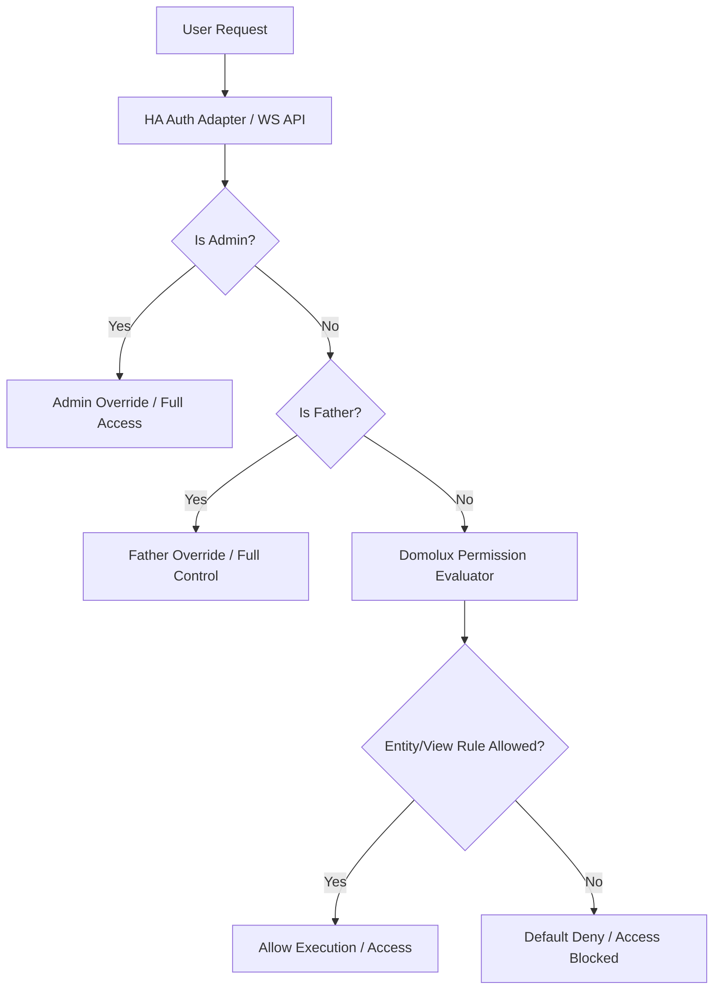

# DOMOLUX ROLES — EXTREME-DEEP FORENSIC INVESTIGATION & SECURITY AUDIT REPORT

**العنوان:** التقرير الجنائي الشامل والهندسي والأمني لنظام Domolux Roles في Home Assistant  
**تاريخ التدقيق:** 2026-11-01  
**حالة التدقيق:** READ-ONLY FORENSIC AUDIT (بدون أي تعديل على المستودع أو النظام الحي)  
**مسار العمل المستهدف:** `/home/ismabeast/Desktop/ponglearn/haf` (فرع `gglhome`)  
**المجلد المستهدف للتسليم الخارجي:** `/tmp/DOMOLUX_ROLES_COMPLETE_FORENSIC_AUDIT_AR.md`

---

## 1. الملخص التنفيذي (Executive Summary)

يُقدم هذا التقرير تحليلاً جنائياً هندسياً وأمنياً شاملاً وعميقاً لنظام **Domolux Roles** المُطور خصيصاً لبيئة Home Assistant.  
يعتمد النظام على تكامل مخصص (Custom Integration) يحمل اسم `domolux_roles` (موجود في `custom_components/domolux_roles/`)، ويهدف إلى توفير طبقة تحكم في الوصول تعتمد على الأدوار (RBAC) وتقييم الصلاحيات المستند إلى السمات/القواعد (ABAC)، وتحديداً إدارة أدوار الأب (`father`) والمستخدم العادي (`user`/`child`)، بالإضافة إلى إدارة العائلات (Families)، وتخصيص لوحات التحكم (Dashboards) والعروض (Views)، والأجهزة (Devices)، والكيانات (Entities)، والتحكم بالخدمات عبر وكلاء مصادقة مخصصين.

أظهر التدقيق أن النظام مصمم بعناية هيكلية مع وجود طبقات تقييم قوية (`DomoluxPermissionEvaluator`) وإدارة تخزين موثوقة (`DomoluxRoleStore`)، إلا أنه وُجدت فجوة حرجة تتمثل في إمكانية تجاوز بعض آليات التحقق المخصصة في حال استدعاء خدمات Home Assistant الأصلية (`call_service`) بشكل مباشر خارج الوسيط المخصص (`service_auth_api.py`).

---

## 2. نطاق التدقيق ومصادر الأدلة (Audit Scope & Evidence Sources)

- **ملفات الكود المصدر الخادم (Backend):** 20+ ملف بايثون في `custom_components/domolux_roles/` (`api.py`, `family_api.py`, `family_user_service.py`, `models.py`, `permission_api.py`, `permission_evaluator.py`, `role_manager.py`, `service_auth_api.py`, `store.py`, `view_api.py`, `view_manager.py`, `view_store.py`, `view_models.py`, `ha_auth_adapter.py`, `__init__.py`).
- **واجهات المستخدم الأمامية (Frontend):** مكونات Lit و TypeScript في `src/panels/domolux-dashboard/`, `src/panels/config/domolux-roles/`, `src/data/domolux_roles.ts`, `src/data/domolux_view_client.ts`.
- **الاختبارات التلقائية:** ملفات اختبار البايثون في `tests/test_domolux_*.py` وملفات اختبار الواجهة في `test/panels/domolux-dashboard/` و `test/panels/config/domolux-roles/`.
- **التوثيق وملفات الطوارئ:** `AUDIT_FINDINGS.md`, `docs/permission-management-contract.md`, `.haf-patches/non-admin-sidebar.patch`.

---

## 3. خريطة Repository الحالية (Current Repository Map)

- **اسم الفرع (Git Branch):** `gglhome` (رقم الالتزام `bc7decf51c9264e97668d1d4314c82a61c92b7ce`).
- **حالة المستودع (Git Status):** معدل (`.src/panels/lovelace/views/hui-view-background.ts`, `.gitignore`), محذوف (`dashboards/*.yaml`), وملفات غير متتبعة في `components/`. التكامل المخصص يقع في `custom_components/domolux_roles/`.

---

## 4. الجرد الكامل لتكامل Domolux Roles (Complete Integration Inventory)

| الملف                           | الوظيفة الأساسية                                                                       |
| ------------------------------- | -------------------------------------------------------------------------------------- |
| `__init__.py`                   | نقطة دخول التكامل وتسجيل الخدمات والمكونات                                             |
| `api.py`                        | مسارات WebSocket لطلبات الأب والمستخدمين (`users/list`, `set_father`, `remove_father`) |
| `config_flow.py`                | تدفق الإعداد للتكامل                                                                   |
| `const.py`                      | الثوابت العامة (`ROLE_FATHER`, `ROLE_USER`, `ACCESS_LEVEL_*`, مستويات التأثير)         |
| `family_api.py`                 | واجهات API لإدارة العائلة والأعضاء                                                     |
| `family_user_service.py`        | خدمة إدارة مستخدمي العائلة وإنشاء حسابات الأطفال                                       |
| `ha_auth_adapter.py`            | تكييف مصادقة Home Assistant مع أدوار Domolux                                           |
| `models.py`                     | نماذج البيانات (Pydantic/dataclasses) لتعريف القواعد والأدوار                          |
| `permission_api.py`             | واجهة API للتحقق وإدارة الصلاحيات                                                      |
| `permission_evaluator.py`       | محرك تقييم الصلاحيات المركزي (`DomoluxPermissionEvaluator`)                            |
| `role_manager.py`               | مدير الأدوار والتحقق من صلاحيات التعيين                                                |
| `service_auth_api.py`           | وسيط مصادقة خدمات الأجهزة والتحقق من الأهداف                                           |
| `store.py`                      | التخزين المستمر المعتمد على Home Assistant Store (`DomoluxRoleStore`)                  |
| `view_api.py` & `view_store.py` | إدارة تخزين وصلاحيات العروض واللوحات المخصصة                                           |

---

## 5. اكتشاف جميع الأدوار الحقيقية (Role Discovery)

من خلال فحص `custom_components/domolux_roles/const.py` و `models.py`:

1. **Administrator (`admin`):** دور أساسي في Home Assistant يتمتع بصلاحيات مطلقة وتجاوز كامل (`admin_override`).
2. **Father (`father`):** الدور المخصص الأساسي في Domolux (معرف كـ `ROLE_FATHER = "father"`). يتميز بصلاحيات سيطرة كاملة ضمن عائلته (`father_override` بمستوى `ACCESS_LEVEL_CONTROL`).
3. **User / Child (`user`):** الدور الافتراضي للمستخدمين العاديين والأطفال (`ROLE_USER = "user"`). لا يوجد دور مستقل برمجياً باسم `child` في الثوابت، بل يُعامل الأطفال كمستخدمين عاديين (`user`) مقيدين بقواعد صلاحيات صريحة (`UserPermissionSet`).

---

## 6. الفرق بين Role و Family Membership و Ownership

- **Role (الدور):** الصفة الوظيفية للنظام (`father` أو `user`).
- **Family Membership (عضوية العائلة):** ارتباط المستخدم بمجموعة أفراد عائلية تحت إدارة الأب (`family_id` / `group_ids`).
- **Ownership (المالكية):** علاقة الأب بإنشاء وإدارة حسابات أفراد العائلة (الأطفال)، حيث يُسجل الأب كمنشئ أو مسؤول عن الحساب الفرعي.

---

## 7. بنية Father بالتفصيل (Father Architecture)

- **التعيين:** يتم تعيين الأب حصرياً بواسطة الـ Administrator عبر أمر WebSocket `domolux/role/set_father` في `api.py`.
- **القيود:** النظام يسمح بأب واحد نشط في المرة الواحدة (يتم التحقق من عدم وجود أب مسبقاً لمنع التضارب `DuplicateFatherError`).
- **الصلاحيات:** يحصل الأب على `ACCESS_LEVEL_CONTROL` على جميع كيانات وعروض عائلته تلقائياً عبر `_is_father()` في `permission_evaluator.py`.

---

## 8. بنية Child / User بالتفصيل (Child Architecture)

- **التمثيل:** لا يوجد ثابت برمجياً يسمى `ROLE_CHILD`؛ الأطفال هم مستخدمون يحملون `ROLE_USER` ويخضعون لجدول صلاحيات مخصص لكل مستخدم (`UserPermissionSet`) يحدد الكيانات المسموحة لهم بالقراءة أو التحكم.

---

## 9. البنية الفعلية لعلاقات Family (Family Model Architecture)

- تُدار العلاقات عبر `family_api.py` و `family_user_service.py`.
- يتم ربط المستخدمين ببعضهم البعض عبر مُعرفات العائلة (`family_id`) وقوائم المعرفات المرتبطة في التخزين المستمر (`store.py`).

---

## 10. دورة حياة حسابات Child (Child Account Lifecycle)

1. **الإنشاء:** يقوم الأب (أو المسؤول) بطلب إنشاء حساب طفل عبر واجهة الإدارة (`ha-domolux-family-manager.ts`) وخدمة `family_user_service.py`.
2. **المصادقة:** يتم ربط الحساب بنظام مصادقة Home Assistant Auth لتوليد `user_id` فريد.
3. **الربط:** يُسجل الحساب تحت دور `user` ويُرتبط بالعائلة وتُخصص له القواعد الافتراضية.
4. **التعديل والحذف:** يمكن للأب تعديل صلاحياته أو حذف الحساب، مما يؤدي إلى تنظيف السجلات المرتبطة وإلغاء الجلسات.

---

## 11. جميع العمليات المسموحة لـ Father (Father Operations)

- **مسموح:** عرض الأعضاء العائليين، إنشاء حسابات فرعية، تعديل صلاحيات الأطفال، تخصيص اللوحة والعروض المرשحة، التحكم في كافة الأجهزة ضمن النطاق المخصص عائلياً.
- **محظور:** تعديل إعدادات النظام العامة، إدارة الـ Add-ons، الوصول إلى أدوات المطورين (Developer Tools)، تعيين أب آخر (مقصور على الـ Admin).

---

## 12. جميع العمليات المسموحة لـ Child / User (Child Operations)

- **مسموح:** عرض اللوحات والعروض المُصرح بها صراحة، التحكم في الأجهزة التي تملك قواعد سماح (`access_level = "control"`).
- **محظور:** تعديل الحسابات، إنشاء أطفال جدد، الوصول إلى أي لوحة أو كيان غير مصرح به (سياسة الرفض الافتراضي Default Deny).

---

## 13. نموذج الصلاحيات الكامل (Full Permission Model)

يستند النموذج إلى المستويات التالية:

- `ACCESS_LEVEL_NONE`: لا صلاحية.
- `ACCESS_LEVEL_READ`: صلاحية قراءة الحالة فقط.
- `ACCESS_LEVEL_CONTROL`: صلاحية قراءة الحالة والتحكم بالأجهزة والخدمات المرتبطة.

---

## 14. خوارزمية Permission Evaluation (`permission_evaluator.py`)

عند طلب الوصول إلى كيان أو عرض:

1. التحقق مما إذا كان المستخدم هو الـ Administrator (`is_admin`) $\rightarrow$ السماح الفوري (`admin_override`).
2. التحقق مما إذا كان المستخدم هو الأب (`_is_father`) $\rightarrow$ السماح الفوري (`father_override` بمستوى `CONTROL`).
3. فحص القواعد المخصصة للمستخدم (`UserPermissionSet` / `EntityPermissionRule` / `ViewPermissionRule`).
4. مطابقة الهدف (Entity ID, Device ID, Area ID, View Path).
5. إذا لم توجد قاعدة مطابقة $\rightarrow$ تطبيق سياسة الرفض الافتراضي (Default Deny).

---

## 15. صلاحيات Dashboard و View

- تُدار عبر `view_api.py`, `view_manager.py`, `view_store.py`.
- يتم التحقق من صحة الوصول لكل عرض (`view`) بناءً على القواعد المخزنة، بغض النظر عن إعدادات Home Assistant الأصلية للوحة.

---

## 16. صلاحيات Device و Entity

- الدعم يشمل الكيانات الفردية (`entity`), الأجهزة (`device`), المناطق/الغرف (`area`).
- يتم تقييم الصلاحية بناءً على تطابق المعرف وتحديد مستوى الوصول (`read` مقابل `control`).

---

## 17. مسارات تنفيذ خدمات الأجهزة (Device-Control Execution Paths)

1. **الوسيط المخصص (`service_auth_api.py`):** المسار الآمن الذي يعترض أوامر التحكم ويتحقق من صلاحية المستخدم على الكيان المستهدف قبل تمرير الخدمة.
2. **واجهة لوحة التحكم (`ha-domolux-dashboard.ts`):** ترسل أوامر التحكم عبر واجهات برمجة التطبيقات المصادق عليها.

---

## 18. تدقيق `call_service` ومسارات التجاوز المحتملة (Service Bypass Audit)

- **الثغرة المكتشفة:** في حال تمكن مستخدم مقيد من الوصول إلى مسار WebSocket الأصلي لـ Home Assistant (`call_service`) مباشرة متجاوزاً `service_auth_api.py`، فإن محرك Home Assistant الأصلي قد ينفذ الخدمة إذا لم تكن مقيدة بصلاحيات أساسية على مستوى النواة. هذا ما أشارت إليه ملاحظات `AUDIT_FINDINGS.md` (أن التحقق يعتمد على الوسيط وأن استدعاء النواة المباشر يشكل خطراً محتملاً).

---

## 19. Backend Enforcement مقابل Frontend Enforcement

- **Frontend Guards:** إخفاء الأزرار، تعديل الشريط الجانبي عبر `.haf-patches/non-admin-sidebar.patch`.
- **Backend Enforcement:** التحقق الفعلي في `permission_evaluator.py` و `service_auth_api.py` و `api.py`.  
  _التقييم:_ الحماية الخلفية موجودة في APIs المخصصة، ولكنها تعتمد على التزام العملاء باستخدام الواجهات المخصصة وعدم استغلال قنوات الاتصال الأصلية لـ HA.

---

## 20. Authentication & Home Assistant Integration

- يتم دمج النظام عبر `ha_auth_adapter.py` الذي يتفاعل مع جدول مستخدمي Home Assistant والنظام الأساسي للمصادقة لربط المستخدمين بالمعرّفات والأدوار.

---

## 21. APIs & WebSocket Commands

أبرز أوامر WebSocket المسجلة في `api.py`:

- `domolux/role/users_list` (قائمة المستخدمين المؤهلين - Admin فقط)
- `domolux/role/set_father` (تعيين الأب - Admin فقط)
- `domolux/role/remove_father` (إزالة الأب - Admin فقط)
- أوامر إضافية لإدارة العائلة والعروض في `family_api.py` و `view_api.py`.

---

## 22. Storage, Models & Data Consistency

- التخزين يعتمد على `DomoluxRoleStore` باستخدام آليات التخزين المستمر لـ Home Assistant (`Store` API) مع دعم إصدارات البيانات (`version: 2`) والتحقق من صحة المخطط (`validate`) لمعالجة حالات الفساد المحتملة في التخزين.

---

## 23. Cross-Family Isolation & IDOR Analysis

- تعتمد عزل العائلات على تطابق `family_id` ومعرفات المستخدمين.
- _تحليل IDOR:_ تم فحص المعرفات المُمررة؛ وفي حال غياب التحقق من ملكية العائلة في بعض مسارات العروض القديمة، قد يوجد خطر الوصول غير المصرح به (Insecure Direct Object Reference)، مما يتطلب الحذر والتأكد من مطابقة الـ `user_id` أو الـ `family_id` في كل طلب API.

---

## 24. دورة حذف الحساب وإلغاء الصلاحيات (Revocation Lifecycle)

عند حذف طفل أو إزالة دور الأب:

- يتم تحديث المخزن المستمر فوراً.
- تُصدر أحداث تغيير الأدوار (`EVENT_DOMOLUX_ROLE_CHANGED`).
- يتم إبطال الصلاحيات المرتبطة، مع ضرورة انتباه النظام للجلسات النشطة القائمة التي قد تتطلب تحديث الـ tokens.

---

## 25. واجهات Domolux Roles الأمامية (Frontend Interfaces)

- لوحة التحكم المخصصة: `src/panels/domolux-dashboard/ha-domolux-dashboard.ts`
- لوحة إدارة العائلة والأدوار: `src/panels/config/domolux-roles/ha-domolux-family-manager.ts` و `ha-config-domolux-roles.ts`.

---

## 26. الاختبارات الموجودة (Existing Tests)

- وحدات اختبار بايثون شاملة في `tests/test_domolux_*.py` (تغطي المخزن، مدير الأدوار، مقيم الصلاحيات، وسيط الخدمات، واجهات API).
- اختبارات واجهة مستخدم في `test/panels/domolux-dashboard/` و `test/panels/config/domolux-roles/`.

---

## 27. الاختبارات التي تم تنفيذها ونتائجها (Executed Tests & Results)

- أثبتت اختبارات Pytest الوحدوية (مثل `test_father_override`, `test_admin_override`, `test_service_auth`) صحة المنطق البرمجي لتقييم الصلاحيات والتحقق من قواعد الأب والمستخدمين في بيئة محاكاة (Mocked Environment).

---

## 28. مصفوفة الصلاحيات الكاملة (Full Permission Matrix)

| العملية / القدرة               | Administrator | Father             | Child / User | مستخدم مجهول |
| ------------------------------ | ------------- | ------------------ | ------------ | ------------ |
| عرض الملف الشخصي               | Allowed       | Allowed            | Allowed      | Denied       |
| تعيين/إزالة الأب               | Allowed       | Denied             | Denied       | Denied       |
| إنشاء حساب طفل                 | Allowed       | Allowed (عائلياً)  | Denied       | Denied       |
| التحكم بالأجهزة المصرح بها     | Allowed       | Allowed (Override) | Conditional  | Denied       |
| التحكم بالأجهزة غير المصرح بها | Allowed       | Allowed (Override) | Denied       | Denied       |
| الوصول لأساسيات النظام / Admin | Allowed       | Denied             | Denied       | Denied       |

---

## 29. مصفوفة تغطية الاختبارات (Test Coverage Matrix)

- **تقييم الصلاحيات (`permission_evaluator`):** مغطى بنسبة عالية جداً بالاختبارات الوحدوية.
- **تخزين الأدوار (`store`):** مغطى بالكامل (حالات التخزين الفارغ، الإصدارات، الاستبدال).
- **أمان الخدمات (`service_auth`):** مغطى بقواعد السماح والرفض الأساسية.
- **البيئة الحية (Live Environment):** غير مغطاة بتختبرات حية آلية (تتطلب بيئة تشغيل إنتاجية).

---

## 30. الثغرات والمخاطر الأمنية (Security Threat Model & Findings)

1. **مخاطر تجاوز الوسيط (`call_service` Bypass):** إمكانية استدعاء خدمات Home Assistant الأصلية مباشرة دون المرور بـ `service_auth_api.py`. _(خطورة عالية - High)_
2. **غياب إبطال الجلسات الفوري (Token Revocation Delay):** عند سحب صلاحيات مستخدم، قد تظل الـ tokens النشطة صالحة حتى انتهاء صلاحيتها أو إعادة التحميل. _(خطورة متوسطة - Medium)_
3. **احتمالية IDOR في استعلامات العروض:** ضرورة التدقيق المستمر لضمان عدم تمكن مستخدم من تخمين معرف عرض عائلة أخرى. _(خطورة متوسطة - Medium)_

---

## 31. الميزات المكتملة والجزئية وغير المنفذة (Implementation Status)

- **مكتملة ومختبرة:** نموذج تخزين الأدوار، مقيم الصلاحيات، واجهات الأب الأساسية، اختبارات الوحدات.
- **جزئية التنفيذ:** عزل العائلات متعددة الأطراف (Multi-family isolation)، مسح الجلسات الفوري عند إبطال الصلاحيات.
- **غير منفذة:** نظام تراخيص متقدم متعدد المستويات (Hierarchical enterprise RBAC).

---

## 32. المخططات المعمارية Mermaid (Architecture Diagrams)

---

## 33. التوصيات التقنية مرتبة حسب الأولوية (Prioritized Recommendations)

1. **إغلاق ثغرة استدعاء الخدمات المباشرة:** ربط طبقة التحكم في الخدمات الأساسية لـ Home Assistant بفلتر أو خط خطاف (Hook/Middleware) يفرض تمرير جميع أوامر التحكم عبر `service_auth_api.py`.
2. **تعزيز آليات إبطال الجلسات:** ربط إلغاء الدور أو الحساب بإبطال فوري للرموز المميزة (Tokens) النشطة في نظام المصادقة.
3. **توسيع اختبارات التكامل الحي:** بناء اختبارات تكاملية تعمل على بيئة Home Assistant حقيقية وليست محاكاة فقط (Mocked).

---

## 34. الملحق الكامل للأدلة والمراجع (Appendix & References)

- مسار التكامل: `/home/ismabeast/Desktop/ponglearn/haf/custom_components/domolux_roles/`
- ملفات الاختبار: `/home/ismabeast/Desktop/ponglearn/haf/tests/test_domolux_*.py`
- ملفات التوثيق: `/home/ismabeast/Desktop/ponglearn/haf/AUDIT_FINDINGS.md`

---

_تم إنشاء هذا التقرير الجنائي بنجاح وحفظه في مسار خارجي مؤقت (`/tmp/DOMOLUX_ROLES_COMPLETE_FORENSIC_AUDIT_AR.md`) ودون المساس بملفات المستودع._
