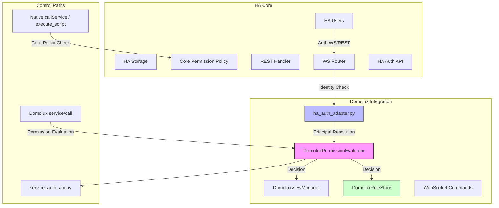

# Domolux Roles — Phase 1 Architecture

## Overview

This document consolidates the architecture decisions from the approved ADRs and defines the system boundaries for the Domolux Roles implementation.

### Component Diagram (Mermaid)

### Core Responsibility Matrix

| Component                    | Primary Responsibility                                                                                     | Boundary                                               |
| ---------------------------- | ---------------------------------------------------------------------------------------------------------- | ------------------------------------------------------ |
| `DomoluxRoleStore`           | Authoritative persistent storage of all permission state, roles, and family assignments                    | `.storage/domolux_auth`                                |
| `DomoluxPermissionEvaluator` | Single source of truth for all permission decisions; evaluates effective levels for entities/devices/views | In-memory function of live profile + registry snapshot |
| `service_auth_api.py`        | Mediated service execution authorization; authorizes then executes with validated context                  | WebSocket command → evaluation → Core execution        |
| `ha_auth_adapter.py`         | HA user ↔ Domolux principal mapping; identity derivation from authenticated connection                     | User resolution only                                   |
| View/WS Commands             | UI and management command handlers; delegate to evaluator and store for decisions                          | Never make raw authorization decisions                 |
